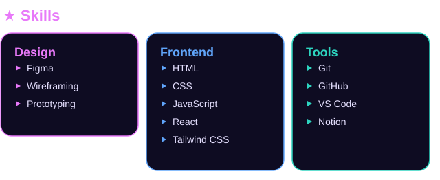

<table>
<tr>
<td width="35%" valign="top"></td>
<td width="65%" valign="top">

</td>
</tr>
</table>

## 📈 Contribution Activity

<picture>
  <source media="(prefers-color-scheme: dark)" srcset="https://raw.githubusercontent.com/pakialakshmi/jannu/output/github-snake-dark.svg">
  
</picture>

<table>
<tr>
<td valign="top"></td>
<td valign="middle" align="center"></td>
</tr>
</table>

